# INSPIRATION-ANALYSIS.md: Reference Breakdown

Evidence for [DESIGN.md](./DESIGN.md), [MOTION.md](./MOTION.md) and [PAGES.md](./PAGES.md).

**Method.** The supplied screen recording (≈40.6 s, 1158×708, 30 fps) was sampled every
2.5 s into 16 frames stored in `reference/frames/`. Frames show *states*, not transitions; motion
descriptions below are therefore marked **[observed]** (visible in a frame or frame pair) or
**[inferred]** (the likely mechanism connecting frames). Inferred behaviour is a design
proposal, not a transcription: tune it in the browser.

Two references:

- **Reference A, "Kristin Watson" recording** → inner-page language (Work, About, Archive, Contact, footer).
- **Reference B, "Rabah" screenshot** → **the home page** (`reference/home-hero-rabah.png`).

> Content in the references (names, awards, testimonials, stats, locations, copy) belongs to
> other people. **Reuse the patterns, never the content.**

---

## Reference B: Home hero (Rabah screenshot)

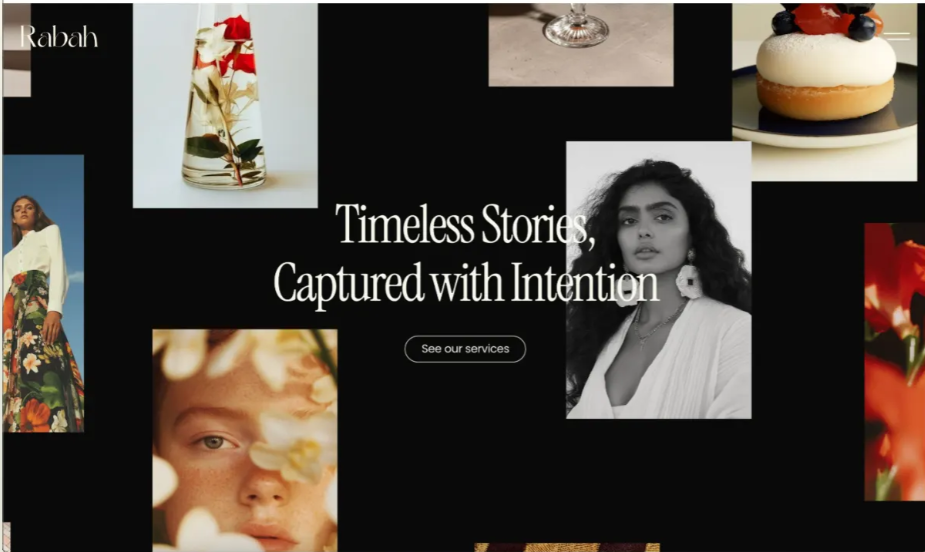

**Observed**

- Near-black canvas (≈ `#0a0a0a`), full-viewport.
- **Scattered image collage**: ~9 photo cards of *varying sizes and aspect ratios* (tall, square,
  landscape) placed around the edges and partly cropped by the viewport. Images bleed off all four edges.
- Cards are **sharp-cornered**, no border, no shadow. Subject matter is mixed (still life, portrait, food, florals).
- **Centred headline** in a high-contrast, condensed editorial serif, two lines, off-white:
  "Timeless Stories, / Captured with Intention". It **overlaps** a portrait card (headline sits *on top of* imagery; the
  portrait on the right partly passes behind the second line).
- Below headline: a small **outline pill button** ("See our services"), thin 1 px off-white stroke, rounded full.
- Top-left: serif wordmark ("Rabah"), light weight. Top-right: **two-line hamburger** icon.
- The centre of the screen is intentionally left empty so the headline reads.

**Pattern to reuse:** collage-around-a-quiet-centre; headline overlapping imagery; minimal chrome.

**[Inferred] motion** (the site is "alive" in the original): cards drift at different parallax
speeds, fade/scale in staggered on load, and probably react to the cursor.

---

## Reference A: Kristin Watson recording, frame by frame

### Frame 01 · `01-hero-split-name.jpg`: Hero

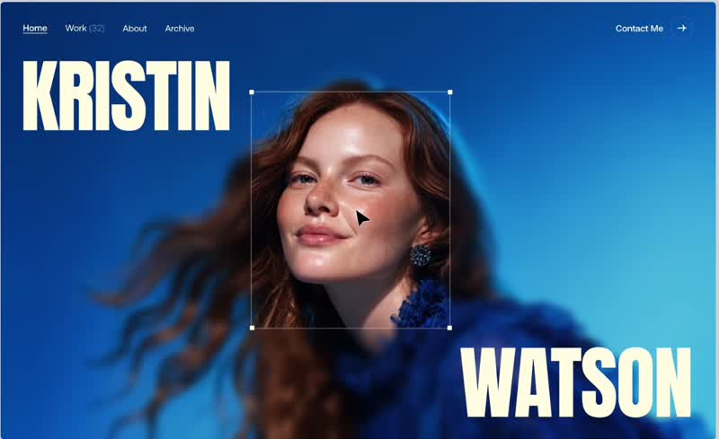

- **Full-bleed colour portrait** (saturated blue background, subject right-of-centre).
- Name set as **giant, tightly-leaded, all-caps condensed sans in cream**, *split*: "KRISTIN" top-left,
  "WATSON" bottom-right, framing the subject diagonally.
- A thin **selection/crop frame with corner handles** (like a Photoshop transform box) sits around the
  subject's face. **[observed]** The face inside is a *different image state* than the background in other frames (frames 15/16:
  smiling vs. neutral), so the box is a **window that cycles/reveals alternate images**, **[inferred]** and likely follows the cursor or ticks over time.
- Top nav, tiny: `Home` (underlined = active) · `Work (32)` (count in superscript-style grey) · `About` · `Archive`; right: `Contact Me` + circled arrow.
- A black **arrow cursor** is visible, so the page uses the native cursor on the hero (custom cursor appears elsewhere).

**Pattern to reuse:** diagonal split-name; crop-frame window; counts in nav.

### Frame 02 · `02-about-scroll-reveal-start.jpg`: About, text still dim

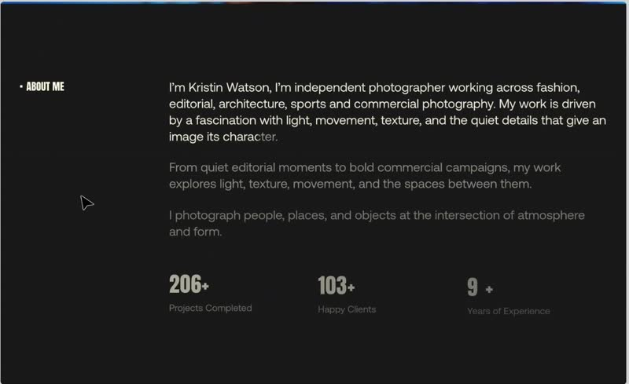

- Dark charcoal (`≈ #161616`). Section label top-left: `• ABOUT ME` (bullet + small caps condensed).
- Three paragraphs, large light sans, left column offset to ~35% width.
- **[observed]** Text is **half-lit**: the first lines are cream, later lines dim grey; the cut is mid-line ("charac|ter").
  → **scroll-linked text colour reveal** (per character/word opacity).
- Stats row below: `206+ Projects Completed`, `103+ Happy Clients`, `9 + Years of Experience`, dim; **numbers are mid-count**.

### Frame 03 · `03-about-reveal-complete-stats.jpg`: About, finished

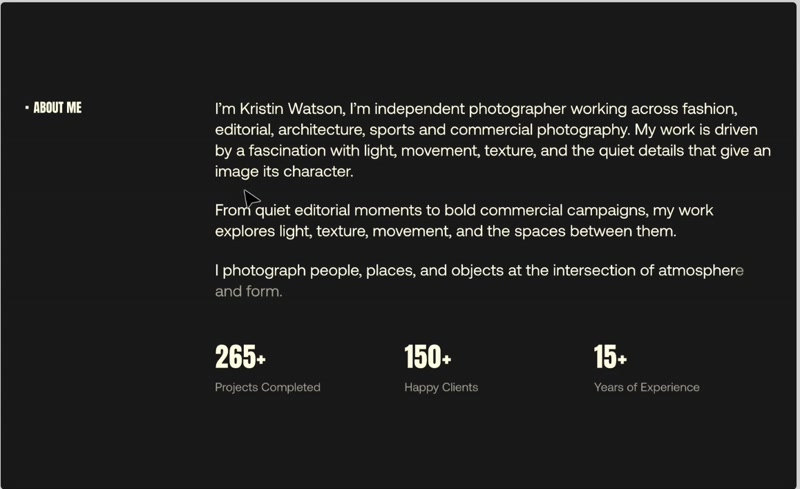

- Text fully cream; stats now **final values** (265+, 150+, 15+). Comparing frames 02→03: values **count up** while the section scrolls in.
- Stats: big condensed numerals with a small "+" top-right, tiny grey label underneath.

### Frames 04-06 · `04-work-selector-portrait.jpg`, `05-…02.jpg`, `06-…03.jpg`: Work selector

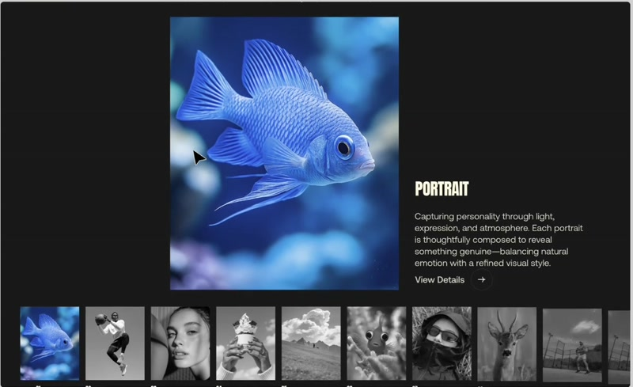
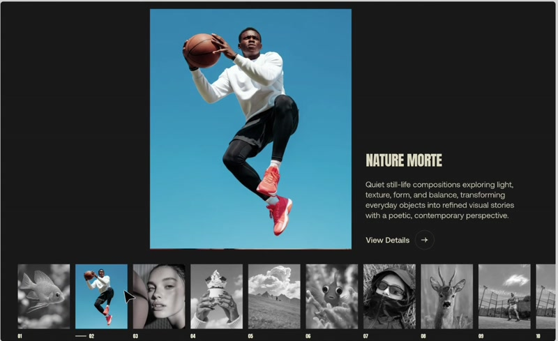
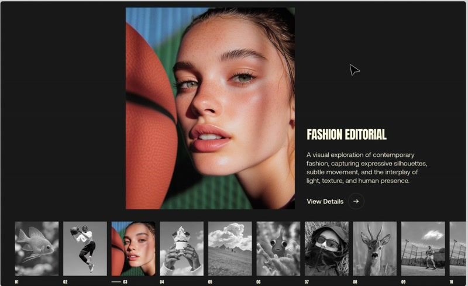

- **Centered tall portrait image** (≈ 3:4) with, to its lower-right, a **title** (condensed caps: PORTRAIT / NATURE MORTE / FASHION EDITORIAL), a 3-line description and `View Details →`.
- **Bottom filmstrip**: ~10 thumbnails in a row, **greyscale** except the **active** one (full colour). Active has a small line + index (`02`) beneath; others show `01 … 10`.
- **[observed]** Across 04→05→06 the big image and title **change in lock-step** with the active thumbnail. Text and image swap; the strip may scroll horizontally to keep the active thumb in view.
- **[inferred]** Hover/click on a thumb *or* time/scroll progress moves the active index (cursor appears on the thumbnails in frames 05-06 → hover-driven). Transition: cross-fade + slight scale, text lines slide up.
- Pointer is a native arrow; the large image stays centred as the page "pins" while selection changes (**[inferred]** scroll-pinned section).

**Pattern to reuse:** the **Featured Selector**, a pinned section where a filmstrip drives a large image + caption. Ideal for choosing among a studio photographer's collections.

### Frames 07-09 · `07-awards-list-hover-a/b/c.jpg`: Awards list with hover preview

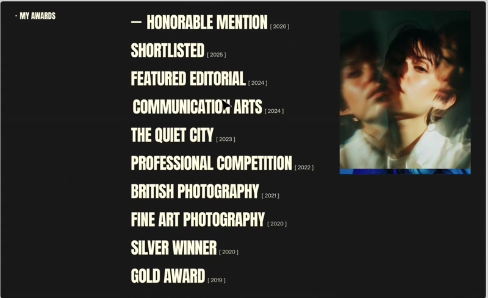
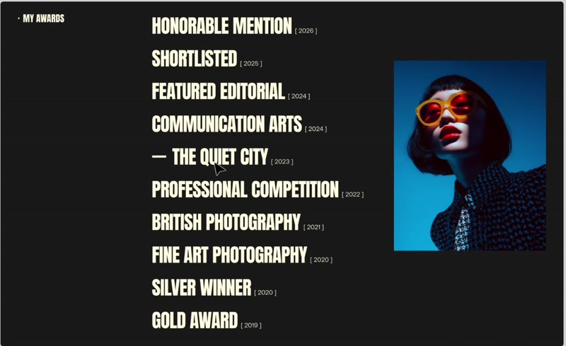
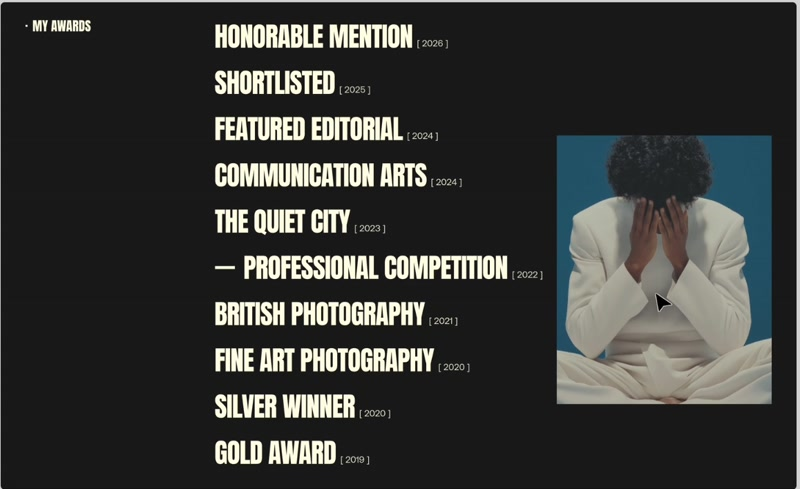

- Label `• MY AWARDS`; a **vertical list of huge condensed uppercase titles**, each with a tiny bracketed year `[ 2026 ]` set top-right of the title.
- **[observed]** The hovered row gets a leading **em-dash "—"** (frames 07: first row; 08: "THE QUIET CITY"; 09: "PROFESSIONAL COMPETITION") and a **portrait preview image** appears at the right.
- **[observed]** The preview image **follows the pointer's vertical position** (it sits higher in 07, lower in 08/09), a floating hover-reveal that tracks the cursor with lag. Image content changes per row.
- Rows share a left edge; the dash pushes the text right (text indents when hovered).

**Pattern to reuse:** hover-reveal list. For Zetona_E this becomes **"Collections index"** or **"Selected Sessions"** (a list of shoot titles with a year and a floating preview). *Never reuse the awards content.*

### Frames 10-12 · `10-locations-spain / 11-dubai / 12-bangkok`: Full-bleed project sections

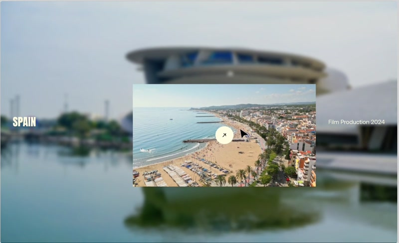
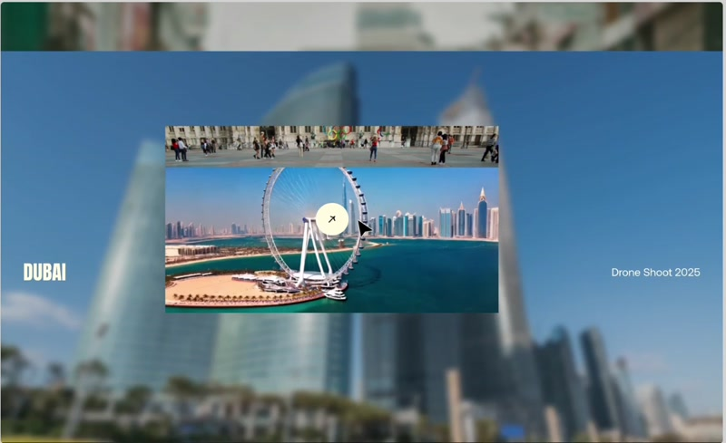
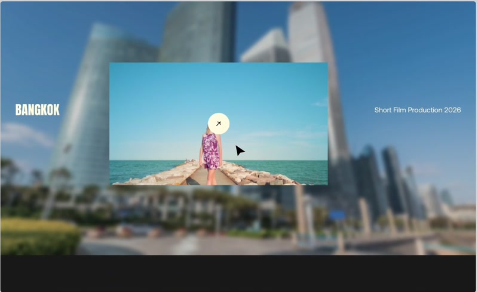

- Each project is a **full-viewport section**: the *same photo* is used as a **heavily blurred, enlarged background**, with a **smaller sharp inset** version centred.
- Left: place name in condensed caps (SPAIN / DUBAI / BANGKOK). Right: tiny category + year (`Film Production 2024`, `Drone Shoot 2025`, `Short Film Production 2026`).
- **[observed]** A **round white cursor-badge with a ↗ arrow** sits in the centre of the inset: the **custom "View" cursor**. The black pointer is also visible, so the badge is an element that appears on hover/over the image.
- **[observed]** In frame 11 the inset image shows **two stacked image slices** (a street strip over the main image), indicating a **slide/reveal transition in progress** (a vertical wipe or slice).
- **[inferred]** Scrolling transitions between sections: the inset scales/clips in from a smaller frame, the blurred background cross-dissolves to the next photo.

**Pattern to reuse:** "Cinematic Project Section". For a portrait photographer, each **collection or featured shoot** gets this treatment with a blurred-backdrop + sharp inset, which is *beautiful with portraits*.

### Frame 13 · `13-testimonials.jpg`: Testimonials

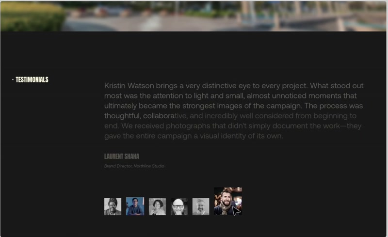

- Label `• TESTIMONIALS`; a long quote in large light type, again **half-lit** (scroll/progress colour reveal), author in condensed caps + italic role.
- A row of **tiny avatar thumbnails** (greyscale; active in colour) selects the testimonial, **the same filmstrip metaphor as the Work selector**.

**Pattern to reuse:** only when the client supplies **real** testimonials (Q8). Otherwise hidden.

### Frame 14 · `14-footer-lets-talk.jpg`: Footer / contact

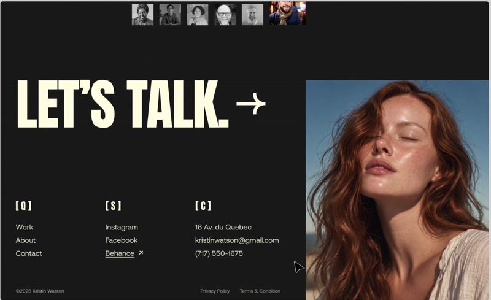

- Enormous **"LET'S TALK. →"** in cream condensed caps; a **large portrait** fills the right ~30% of the screen, full height, edge-to-edge.
- Three link columns with **bracketed labels** `[Q]` (quick links: Work/About/Contact), `[S]` (socials: Instagram/Facebook/Behance↗), `[C]` (contact: address/email/phone).
- Bottom bar: `©2026 …` left; `Privacy Policy · Terms & Condition` right. The avatar strip from testimonials is still visible at the top, so the footer scrolls in right after.

**Pattern to reuse:** giant CTA + full-height portrait + `[Q] [S] [C]` columns. Excellent for a portrait photographer.

### Frames 15-16 · `15-hero-loop-blur-transition.jpg`, `16-hero-loop-return.jpg`: Loop

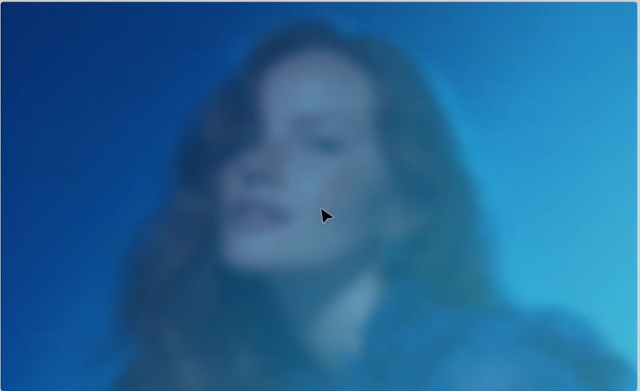
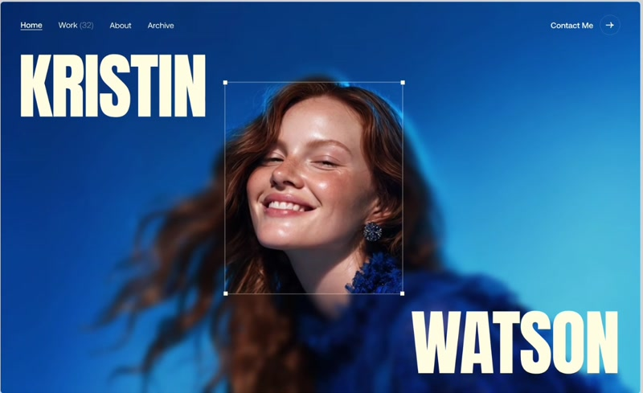

- Frame 15: the hero image is **heavily blurred and zoomed** (a page-transition or "route/loader" state).
- Frame 16: back at the hero with a **different crop-box image** (smiling), name text now `KRISTIN / WATSON` at slightly lower positions: the text **re-enters from the bottom** as the page reloads.
- Conclusion: **page transitions use blur-to-sharp image reveal**, and the hero image inside the crop frame changes each cycle.

**Pattern to reuse:** route transition = blur/scale-in of the destination hero + headline slide-up.

---

## Synthesis: the "pattern library" extracted

| Pattern ID | Name | Source | Used on |
|-----------|------|--------|---------|
| P1 | **Floating Collage Hero** | B | Home |
| P2 | **Split-Name Hero + Crop Frame** | A f01 | About hero / optional Home variant |
| P3 | **Scroll-Lit Text** (per-word reveal) | A f02-03, f13 | About, Home teaser |
| P4 | **Count-Up Stats** | A f02-03 | Hidden until real data |
| P5 | **Pinned Filmstrip Selector** | A f04-06 | Home "Selected Work", Work index |
| P6 | **Hover-Reveal List w/ Cursor-Tracking Preview** | A f07-09 | Work index (list view), Archive filter |
| P7 | **Cinematic Blur-Backdrop Section + "View" cursor** | A f10-12 | Collection intro / featured shoots |
| P8 | **Avatar-Strip Switcher** | A f13 | Testimonials (hidden until real) |
| P9 | **Giant CTA Footer + Full-Height Portrait + [Q][S][C]** | A f14 | Global footer / Contact |
| P10 | **Blur-to-Sharp Page Transition** | A f15-16 | Route changes |
| P11 | **Minimal nav w/ counts and circled-arrow CTA** | A f01 | Header |
| P12 | **Bracketed index typography** `[ 2026 ]`, `[Q]`, `01…10` | A | Labels throughout |

## Open design options (to show the client, per the brief: "describe the options for the pages")

| Option | Description | Default |
|--------|-------------|---------|
| H-A | Home = Floating Collage Hero (P1) | ✅ **Chosen** (client liked) |
| H-B | Home hero alt: split-name + crop frame (P2) | Alt, reachable via a feature flag for client A/B review |
| W-A | Work index = Pinned Filmstrip Selector (P5) | ✅ default desktop |
| W-B | Work index = Hover-reveal list (P6) | Alt; also the keyboard-friendly list view toggle |
| W-C | Work index = simple card grid | ✅ default mobile |
| C-A | Collection page = masonry gallery + lightbox | ✅ |
| C-B | Collection page = cinematic stacked sections (P7) | Optional "Story mode" toggle for collections with ≤ 8 photos |
